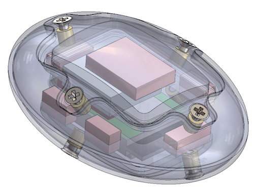

# PETRAS – PEbble TRAcking Sensor

PETRAS is an open-source smart pebble for experimental sedimentology. It is an ellipsoidal, 3D-printed pebble with an embedded inertial measurement unit (IMU). Its mass, mean density and principal moments of inertia are tuned to match a homogeneous natural pebble of the same shape, so its motion in bedload transport is *kinematically equivalent* to that of a real pebble.

<p align="center">
  
</p>

This repository contains everything needed to build and use a PETRAS pebble:

- the **design tool** that determines the sizes of the internal ballast for kinematic equivalence based on the desired ellipsoidal pebble shape,
- the automated **CAD geometry** of the pebble based on the designer tool's output,
- the **firmware** running on the embedded ESP32-S3 board,
- the **desktop controller application** for configuration, calibration and live monitoring (MATLAB),
- the **calibration rig** firmware for angular-velocity scale calibration.

---

## Repository structure

```
PETRAS/
├── 00_PCB/                        # PCB of the inertial measurement unit (files available on request)
├── 01_Designer/                   # Pebble design: ballast optimisation + CAD geometry
│   ├── main.m                     # Genetic-algorithm design script (MATLAB)
│   ├── SmartPebble.m              # Class holding the target pebble properties
│   └── Geometry/                  # SolidWorks parametric model
│       ├── full_assembly_FDM_SLA.SLDASM
│       ├── parameters.txt         # Global variables driving the SolidWorks model
│       ├── M2_threaded_insert.SLDPRT
│       ├── M2x6.SLDPRT
│       └── pcb_rough (1).stp.SLDPRT
├── 02_Firmware/                   # Embedded firmware (PlatformIO, ESP32-S3, Arduino)
│   ├── platformio.ini
│   ├── src/main.cpp
│   └── matlab/quat2angvel.m       # Post-processing helper
├── 03_CalibrationServoControl/    # Stepper-motor rig for gyroscope scale calibration
│   ├── angVelCalibration.ino/angVelCalibration.ino.ino
│   ├── angVelCalibrationShell.STL # 3D-printable holder for the pebble
│   └── Example.txt                # Example calibration.txt produced by the firmware
├── 04_ControllerApplication/      # Desktop app (MATLAB App Designer)
│   ├── main.mlapp
│   ├── MovingBuffer.m
│   ├── EP.stl                     # Example pebble shape for the 3D live view
│   └── PETRAS.svg / PETRAS48.png
├── docs/                          # Images used in this README
├── LICENSE                        # GNU GPL v3.0
└── README.md
```

---

## Requirements

| Part | Software | Notes |
|---|---|---|
| Designer | MATLAB + **Global Optimization Toolbox** (`ga`) | SolidWorks to regenerate the CAD model |
| Firmware | [PlatformIO](https://platformio.org/) (VS Code extension or CLI) | Libraries are installed automatically from `platformio.ini` |
| Controller application | MATLAB R2021b or newer with App Designer | Uses `tcpclient`, `stlread`, `triangulation` |
| Calibration rig | Arduino IDE or PlatformIO + [FastAccelStepper](https://github.com/gin66/FastAccelStepper) | Any FastAccelStepper-compatible board with a stepper driver |

**Hardware (pebble):** Inertial measurement unit (PCB files available on request), [Resione Anti Impact](https://www.resione.com/products/anti-impact?srsltid=AYCX9vLUatYJh8HE3x9Hs9cMIWtHIoK9scddUxa9VKULaWjJYRIFlotU) resin, M2x6 screws (bugle head), [M2 threaded inserts](https://www.3djake.com/ruthex/threaded-insert-m2-70-pieces?sai=15204), [Copper-filled filament](https://www.3djake.com/colorfabb/copperfill-750-g?sai=214), 1 mm silicone sheet, two-component epoxy resin.

---

## Getting started

The usual workflow is **Design → Build → Flash → Calibrate → Measure → Post-process**.

### 1. Design the pebble (`01_Designer/`)

1. Set the target pebble in `SmartPebble.m`:
   - semi-axes `a`, `b`, `c` [m],
   - target density `rho_desired`, ballast density `rho_ballast`, resin density `rho_resin`,
   - the electronics `cavity` size and `shell_thickness`.
2. Run `main.m`. With `GA = true`, a genetic algorithm searches for the sizes and positions of the ballast blocks (`X1..Z3`, `xshift..zshift`) and for the infill density of the internal shell. The aim is for the pebble's mass and principal moments of inertia to match those of the homogeneous ellipsoid.
3. The final population is plotted (inertia error vs. density). **Click a point** to choose a candidate, then close the figure.
4. The script prints a report (mass, mean density, inertia error, infill density, principal inertias) and generates a 'parameters.txt' file including the data for the automated geometry generation.

### 2. Build the geometry (`01_Designer/Geometry/`)

Open `full_assembly_FDM_SLA.SLDASM` in SolidWorks. Link the new `parameters.txt` to the equations, so rebuilding the model applies the new design. Export the shell parts as STL and for printing. The report printed (step 1.4) contains an estimation of the internal shell's infill ratio. Inner and outer shell parts should be printed with FDM and SLA printers, respectively.

### 3. Flash the firmware (`02_Firmware/`)

```bash
cd 02_Firmware
pio run -e esp32-s3-devkitm-1-USB -t upload      # first upload over USB
pio run -e esp32-s3-devkitm-1-OTA -t upload      # later uploads over WiFi (OTA, host PETRAS.local)
pio device monitor                               # 115200 baud
```

For OTA, your computer must be connected to the pebble's WiFi network (see below).

At start-up the firmware does the following:
- turns off Bluetooth and starts the IMU at **1000 Hz**, **±16 g** and **±2000 °/s**,
- mounts the microSD card, **deletes earlier measurement files** (it keeps `config.txt` and `calibration.txt`) and loads the calibration,
- runs in one of two modes:
  - **Remote mode** (no `config.txt` on the SD card): opens a WiFi access point and waits for commands over TCP.
  - **Standalone mode** (`config.txt` present): runs the commands in `config.txt` line by line without WiFi, then switches to remote mode.

**Default network settings** (defined at the top of `02_Firmware/src/main.cpp`):

| Setting | Value |
|---|---|
| WiFi SSID / password | `PETRAS` / `smartpebble` |
| Device IP | `192.168.1.1` |
| Command port (TCP) | `80` |
| FTP (port 21) user / password | `admin` / `admin` |

> 🔒 Change these credentials before using the device anywhere public.

### 4. Connect with the controller application (`04_ControllerApplication/`)

1. Connect your computer to the `PETRAS` WiFi network.
2. Open `main.mlapp` in MATLAB (App Designer) and run it.
3. Enter the IP address (`192.168.1.1`) and port (`80`), then press **Connect**.

The application provides:
- **Live test:** streams IMU data at about 100 Hz, estimates the orientation with a Madgwick filter, and shows it on a 3D model of the pebble (load your own pebble STL with **Load STL file**; `EP.stl` is an example).
- **Calibration:** accelerometer offset, gyroscope offset and gyroscope scale (X/Y/Z).
- **Measurement:** start a recording with a file name and duration (WiFi can optionally stay on), delete measurement data, reset the device or put it to sleep.
- **Data download:** start the on-board FTP server and fetch the CSV files with any FTP client (`192.168.1.1:21`).
- **Device log:** commands performed by the firmware.

### 5. Calibrate

Calibration requires a constant rotation of the device around any of its principal axes (example contains a servo control firmware and 3D printable socket for this purpose).
Calibration values are stored on the SD card as `calibration.txt` (see `03_CalibrationServoControl/Example.txt` for the format). All measurements carried out after the calibration are corrected with the data stored in the 'calibration.txt' file.

1. **Accelerometer offset:** place the pebble at rest with its **z axis pointing vertically down** and press *Acceleration Offset* (10 s average).
2. **Gyroscope offset:** keep the pebble completely still and press *Angular Velocity Offset* (10 s average).
3. **Gyroscope scale:** use the calibration rig (`03_CalibrationServoControl/`):
   - Print `angVelCalibrationShell.STL` and mount the pebble on the stepper motor with the chosen axis along the rotation axis.
   - Flash `angVelCalibration.ino.ino` (stepper STEP = pin 9, DIR = pin 4, ENABLE = pin 2, start button = pin 5, 200 steps/rev, 1/16 microstepping).
   - Press the button: the rig turns at **3 rev/s for 15 s** (≈ 18.85 rad/s).
   - While it is turning, enter the reference angular velocity in the app (rad/s) and press *Scale Ang. Vel. X/Y/Z* (10 s average). Repeat for each axis.

### 6. Measure

**Remote:** press *Start* in the app. The pebble records to the given file at about 1 kHz and replies `DONE:START_MEASUREMENT` when it has finished.

**Standalone (e.g. in a flume):** put a `config.txt` file in the root of the SD card, with one command per line, for example:

```
WAIT:30
START_MEASUREMENT:/run01.txt, 120, 0
SLEEP:60
START_MEASUREMENT:/run02.txt, 120, 0
```

⚠️ Result files contain raw data without motion recognition, tracking, filtering, etc.

### 7. Post-process

`02_Firmware/matlab/quat2angvel.m` computes the body-frame angular velocity (rad/s) from an orientation quaternion series (with Madgwick filter). This gives a smooth angular-velocity signal that is consistent with the orientation estimate.

```matlab
omega = quat2angvel(q, Fs);                              % q: Nx4 [w x y z], Fs in Hz
omega = quat2angvel(q, Fs, 'Method', 'derivative', 'SmoothWindow', 5);
```

---

## Command reference (TCP / `config.txt`)

Commands are plain-text lines: `COMMAND` or `COMMAND:param1, param2, ...`.

| Command | Parameters | Description |
|---|---|---|
| `START_MEASUREMENT` | `fileName, duration_s, keepWiFiOn (0/1)` | Records IMU data to `fileName` on the SD card |
| `START_LIVE_TEST` / `STOP_LIVE_TEST` | – | Streams `DATA:` lines (batches of 5 samples every 50 ms) |
| `START_FTP_SERVER` / `STOP_FTP_SERVER` | – | Turns the FTP server on or off |
| `PURGE_DATA` | – | Deletes measurement files (keeps the config, calibration and event log) |
| `START_ACCEL_OFFSET` | `duration_s` | Accelerometer offset calibration |
| `START_GYRO_OFFSET` | `duration_s` | Gyroscope offset calibration |
| `START_GYRO_SCALE` | `axis (X/Y/Z), duration_s, refVel_deg_s` | Gyroscope scale calibration |
| `WAIT` | `seconds` | Blocking wait |
| `SLEEP` | `seconds` | Light sleep with WiFi off |
| `RESET` | – | Restarts the device |

All events are also written to `/eventLog.txt` on the SD card.

---

## Citation

If you use PETRAS or any part of this repository in your research, please cite:

> B. Havasi-Tóth, "PETRAS: Modular Kinematically Equivalent Smart Pebbles for Investigating Shape-Dependent Bedload Motion," *IEEE Sensors Journal*, vol. 26, no. 22, pp. 35178–35187, 2026, doi: [10.1109/JSEN.2026.3740924](https://doi.org/10.1109/JSEN.2026.3740924).

```bibtex
@ARTICLE{11733701,
  author={Havasi-Tóth, Balázs},
  journal={IEEE Sensors Journal}, 
  title={PETRAS: Modular Kinematically Equivalent Smart Pebbles for Investigating Shape-Dependent Bedload Motion}, 
  year={2026},
  volume={26},
  number={22},
  pages={35178-35187},
  keywords={Shape;Elementary particles;Measurement;Image sensors;Optimization;Design methodology;Measurement units;Sediments;Fluid flow;Ellipsoids;Experimental sedimentology;inertial measurement unit (IMU);kinematic equivalence;pebble motion;smart pebble},
  doi={10.1109/JSEN.2026.3740924}}
```

---

## License

This project is licensed under the **GNU General Public License v3.0**. See the [LICENSE](LICENSE) file for details.

You may use, modify and redistribute this work, provided that derivative works are distributed under the same license and their source is made available.
